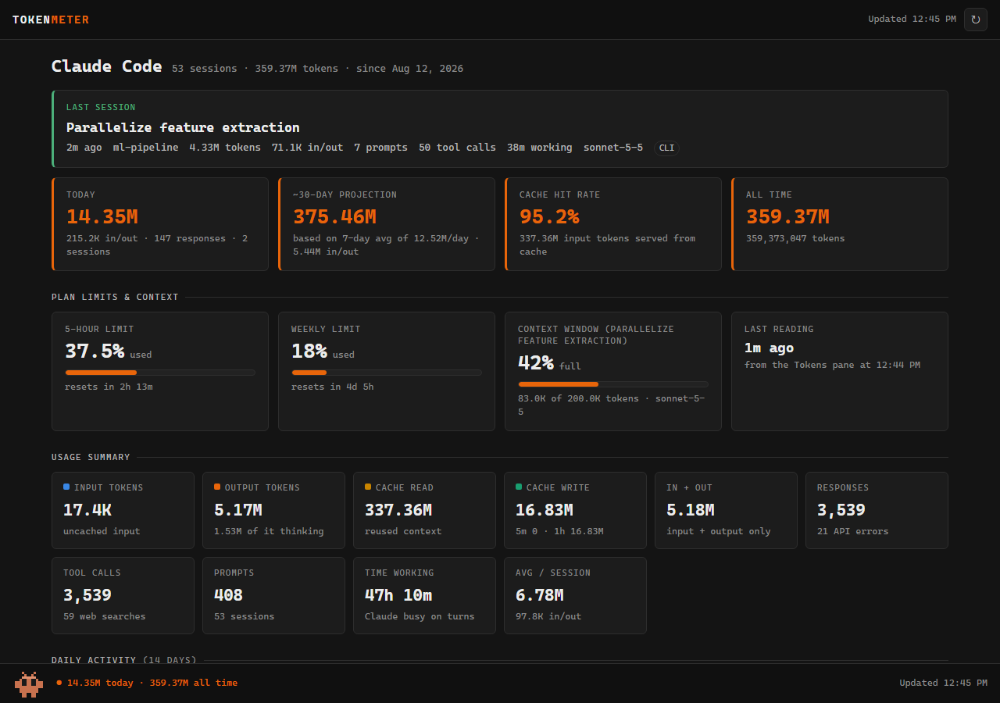
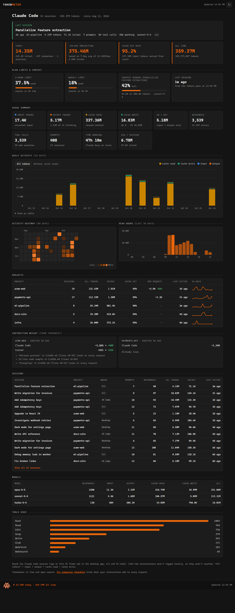
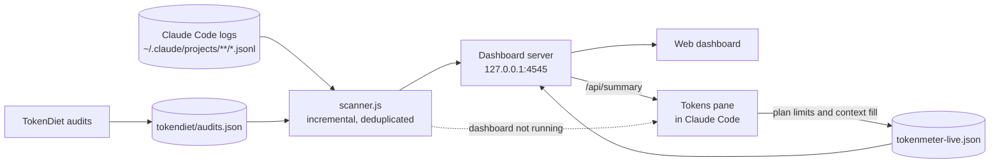

<h1 align="center">Tokenmeter for Claude Code</h1>

<p align="center">
  See where your Claude Code tokens go: a live pane inside every session, and a local dashboard with the full history.
</p>

<p align="center">
  <a href="https://github.com/bar-madar/claude-tokenmeter/actions/workflows/ci.yml"></a>
  <a href="LICENSE"></a>
  
  
  
</p>

<p align="center">
  
</p>

> Screenshots use the built-in demo data (`npm run demo`), not anyone's real usage.

## Features

**Tokens pane**, inside Claude Code (desktop app Code tab, terminal and VS Code):

- This session's tokens: input, output, cache read and write, thinking, responses and tool calls
- How full the context window is
- Your 5-hour and weekly plan limits, with when each resets
- Today, the last 7 days, a 30-day projection and all-time totals
- Refreshes after every reply and every minute; `/tokens` reopens it
- The latest [TokenDiet](#works-with-tokendiet) audit of the project, and a tip when a session gets heavy

**Web dashboard**, on `localhost`:

- Last session pinned at the top, today's usage, cache hit rate and a 30-day projection
- 14-day stacked chart of input, output, cache read and cache write, with a table view
- 90-day activity heatmap and peak hours
- Breakdowns by project (with 14-day sparklines), session, model and tool
- Plan limits and context fill, handed over from the pane
- Instruction weight per project: what your CLAUDE.md and rules files add to every request, from TokenDiet audits
- Auto-refresh every minute, and an idle pixel companion (click it)

**Under the hood**

- Reads the session logs Claude Code already keeps on your machine. No API key, no account, no network.
- Counts every API response exactly once. Claude Code logs a response once per content block, so tools that sum every line overcount about threefold.
- Incremental: after the first scan, a refresh only reads what was appended (milliseconds, even with large logs).
- Zero dependencies: plain Node.js and one HTML page.

<details>
<summary><b>See the whole dashboard</b></summary>
<br>

</details>

## Works with TokenDiet

Tokenmeter shows where your tokens go. [TokenDiet](https://bar-madar.github.io/tokendiet/), its paid companion skill, cuts what your instructions add to every request: it measures the CLAUDE.md, AGENTS.md and rules files of Claude Code, Codex, Cursor, Copilot, Gemini CLI, Windsurf and Cline, and trims them without losing anything.

The two work together:

- **TokenDiet → Tokenmeter.** Each TokenDiet audit leaves a short summary (numbers and finding titles, no file contents) in `~/.claude/tokendiet/audits.json`. The dashboard shows it per project, and the pane shows it for the session's project.
- **Tokenmeter → TokenDiet.** When a session's context passes half the window, or its prompt cache keeps missing, the pane suggests a diet.

Tokenmeter stays free and works fully without TokenDiet.

## Install the pane

From a terminal:

```bash
claude plugin install tokenmeter --marketplace bar-madar/claude-tokenmeter
```

Or at the prompt of a Claude Code session:

```text
/plugin install tokenmeter --marketplace bar-madar/claude-tokenmeter
```

Or in the **Claude desktop app**: click **+** next to the prompt box, choose **Plugins**, then **Add marketplace** with `bar-madar/claude-tokenmeter`, and **Add plugin**.

Start a new session and the **Tokens** pane opens on its own. Type `/tokens` to bring it back after closing it.

What it shows, simplified:

```text
THIS SESSION
3.46M tokens
Input / output              28 / 53.0K
Cache read / write       3.30M / 120.0K
Thinking                          20.0K
Responses · tools               30 · 39
Cache hit                           96%

LIMITS & CONTEXT
Context window                      48%
████████░░░░░░░░
96.0K of 200.0K
5-hour limit                      23.5%
████░░░░░░░░░░░░
resets in 2h 14m

TODAY
14.35M tokens
...
```

## Run the dashboard

```bash
git clone https://github.com/bar-madar/claude-tokenmeter
cd claude-tokenmeter
npm start
```

That opens <http://localhost:4545> in your browser. There's nothing to `npm install`. On Windows you can also double-click `dashboard\start.cmd`.

No Claude Code history yet, or just curious? `npm run demo` starts it on made-up data at <http://localhost:4546>.

When the dashboard is running, the pane reads from it (and shows an **Open dashboard** button); otherwise the pane reads the logs itself.

## Requirements

- **Claude Code** with plugin hooks support (built and tested with 2.1.299). Plugin hooks are an early-access API, so a future Claude Code release may need an update here.
- **Node.js 20 or newer**, on your `PATH`. The pane uses it to read the logs.
- Plan-limit bars appear when you sign in to Claude Code with a Claude subscription. With an API key you still get every token count and the context window.

## How it works



The logs hold each response's token usage but not your plan limits, so the pane also reads those from Claude Code and leaves the latest reading in `~/.claude/tokenmeter-live.json` for the dashboard.

### What the numbers mean

| Term | Meaning |
| --- | --- |
| **Input** | New, uncached input tokens sent with a request |
| **Output** | Tokens Claude wrote, thinking included |
| **Cache read** | Earlier context reused from the prompt cache. Usually the bulk of a long session, and much cheaper than fresh input |
| **Cache write** | Context written to the prompt cache, split into 5-minute and 1-hour entries |
| **All tokens** | Input + output + cache read + cache write |
| **In + out** | Input + output only |
| **Cache hit rate** | Cache read ÷ everything sent as input |
| **Responses** | API responses, each counted once |
| **30-day projection** | The last 7 days' daily average × 30 |

### Why my numbers differ from other tools

Claude Code writes a response to its log once per content block (thinking, text, each tool call), and every copy repeats the same usage. Tokenmeter keys each response by its message and request IDs and counts it once. Tools that add up every line, including Claude Code's own `stats-cache.json`, report roughly three times as many tokens.

## Configuration

| Variable | Default | Effect |
| --- | --- | --- |
| `TOKENMETER_PORT` | `4545` | Port for the dashboard. Set it for Claude Code too, so the pane finds the dashboard. |
| `CLAUDE_CONFIG_DIR` | `~/.claude` | Where Claude Code keeps its data. Tokenmeter follows it. |

## Privacy

Everything stays on your computer. Tokenmeter reads your local Claude Code logs (and TokenDiet's audit summaries, if you use it), listens on `127.0.0.1` only, and sends nothing anywhere: no analytics, no telemetry, no update checks. The only file it writes is `tokenmeter-live.json` in your Claude config folder.

## Limitations

- Covers Claude Code only. Conversations in the Chat tab of the Claude apps aren't logged on your computer.
- Claude Code removes old session logs after a while (30 days by default; see `cleanupPeriodDays`), so history only goes back that far.
- Plan-limit readings come from live sessions; the dashboard shows the most recent one.

## Troubleshooting

<details>
<summary>The pane says it couldn't read the session logs</summary>

The pane runs `node` to read the logs. Check `node --version` works in a terminal. If you installed Node with a version manager, the desktop app may not see it: install Node.js from <https://nodejs.org>, or start the dashboard (`npm start`) so the pane reads from it instead.
</details>

<details>
<summary>The pane doesn't appear</summary>

Plugins load when a session starts, so open a new session after installing. Then type `/tokens`. Run `claude plugin list` to check that `tokenmeter` is enabled.
</details>

<details>
<summary>"Port 4545 is already in use"</summary>

The dashboard is probably already running: open <http://localhost:4545>. Or pick another port with `TOKENMETER_PORT`.
</details>

<details>
<summary>The plan-limit cards are empty</summary>

They fill in after the first reply in a session that has the pane, and only for Claude subscriptions.
</details>

## Development

```text
.claude-plugin/   plugin and marketplace manifests
hooks/            the Tokens pane (a Claude Code plugin hooks module)
types/            the pane's state and data types
scanner.js        log reader, shared by the pane and the dashboard
dashboard/        local server and the web page
scripts/          demo data
tests/            scanner tests (Node) and pane tests (Claude Code)
```

```bash
npm test                 # scanner tests
npm run test:plugin      # plugin checks and pane tests (needs Claude Code)
npm run demo             # dashboard on made-up data
claude --plugin-dir .    # run Claude Code with the pane from this folder
```

See [CONTRIBUTING.md](CONTRIBUTING.md) for more.

## More

- Website: <https://bar-madar.github.io/>
- [TokenDiet](https://bar-madar.github.io/tokendiet/): cut what your instructions add to every request
- Questions: [open an issue](https://github.com/bar-madar/claude-tokenmeter/issues); I reply within 2 business days

## Acknowledgements

The dashboard's look is inspired by [tokenmeter](https://github.com/DewashishCodes/tokenmeter) by Dewashish Lambore, a Windows desktop app for the same logs.

## License

[MIT](LICENSE) © 2026 Bar Madar

Tokenmeter is an independent project, not affiliated with or endorsed by Anthropic. Claude is a trademark of Anthropic.
